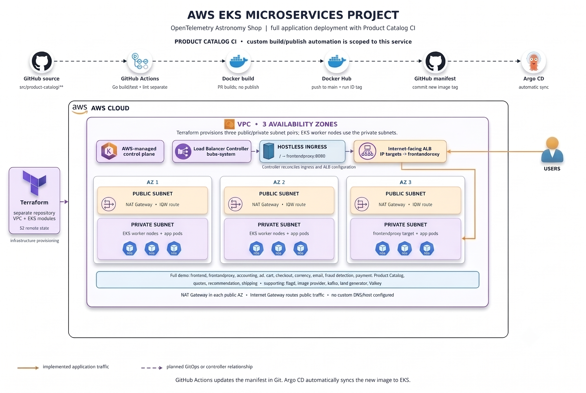

# AWS EKS Microservices Deployment with Terraform and GitOps

A DevOps project deploying the OpenTelemetry Astronomy Shop Demo to Amazon EKS. It combines Terraform-managed AWS infrastructure, Kubernetes workloads, a Product Catalog CI/CD pipeline, Docker Hub image publishing, and Argo CD GitOps deployment.

The application originates from the [OpenTelemetry Demo project](https://github.com/open-telemetry/opentelemetry-demo). This repository focuses on deploying and automating delivery for that application.

## Project Architecture

Terraform infrastructure is maintained in a [separate repository](https://github.com/adityasingh307/three-tier-devops-infrastructure). It provisions a VPC across three Availability Zones, public and private subnets, NAT gateways, Amazon EKS, and a managed node group.

Application traffic flows from the internet-facing Application Load Balancer through a hostless Kubernetes Ingress to the Frontend Proxy Service on port `8080`. The AWS Load Balancer Controller manages the ALB using IP targets. No custom DNS name or host is configured.

## What This Project Demonstrates

- Provisioning AWS networking and EKS with Terraform.
- Deploying the OpenTelemetry Astronomy Shop microservices to Kubernetes.
- Exposing the frontend through the AWS Load Balancer Controller and an ALB Ingress.
- Building and publishing a custom Product Catalog image with GitHub Actions and Docker Hub.
- Updating a Kubernetes image manifest from CI and syncing it with Argo CD.
- Running the application locally with Docker Compose.

## Product Catalog CI/CD

The workflow in [`.github/workflows/ci.yaml`](.github/workflows/ci.yaml) runs for pull requests and pushes to `main` when `src/product-catalog/**` changes.

- Builds the Go service and runs its tests.
- Runs `golangci-lint`.
- Builds the Product Catalog Docker image.
- Publishes the image to Docker Hub on pushes to `main`, using the GitHub Actions run ID as its tag. Pull requests build without publishing.
- Updates `kubernetes/productcatalog/deploy.yaml` with the new tag and commits the manifest update to `main`.
- Argo CD automatically syncs the Product Catalog application from Git.

Required GitHub Actions secrets: `DOCKERHUB_USERNAME`, `DOCKERHUB_TOKEN`, and `TOKEN` for pushing the manifest update.

## Run the Project

- **Local:** Run the full demo with Docker Compose using `make start`; open [http://localhost:8080](http://localhost:8080). Stop it with `make stop`. The repository also provides `make start-minimal`.
- **AWS EKS:** Follow the setup and deployment steps in [`docs/DEPLOYMENT.md`](docs/DEPLOYMENT.md), including Terraform provisioning, kubeconfig setup, the Load Balancer Controller, Kubernetes manifests, and Argo CD.

## Screenshots

Screenshots from the AWS deployment are in [`docs/screenshots/`](docs/screenshots/). The ALB hostname shown in the captures is AWS-generated and may change when the infrastructure is recreated.

## Repository Layout

| Path | Purpose |
|---|---|
| `.github/workflows/ci.yaml` | Product Catalog CI/CD |
| `src/product-catalog/` | Product Catalog Go service |
| `kubernetes/` | Kubernetes application manifests |
| `kubernetes/frontendproxy/ingress.yaml` | ALB Ingress |
| `kubernetes/complete-deploy.yaml` | Combined application manifest |
| `docs/` | Architecture diagram, screenshots, and deployment guide |

## Upstream Project

This project deploys the OpenTelemetry Astronomy Shop Demo from [open-telemetry/opentelemetry-demo](https://github.com/open-telemetry/opentelemetry-demo).

## Author

[Aditya Singh](https://github.com/adityasingh307)
